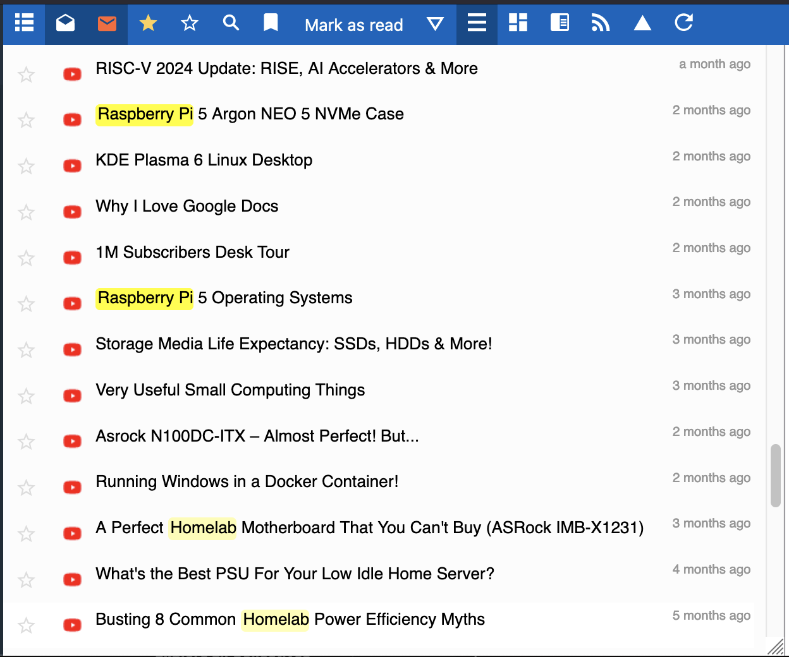
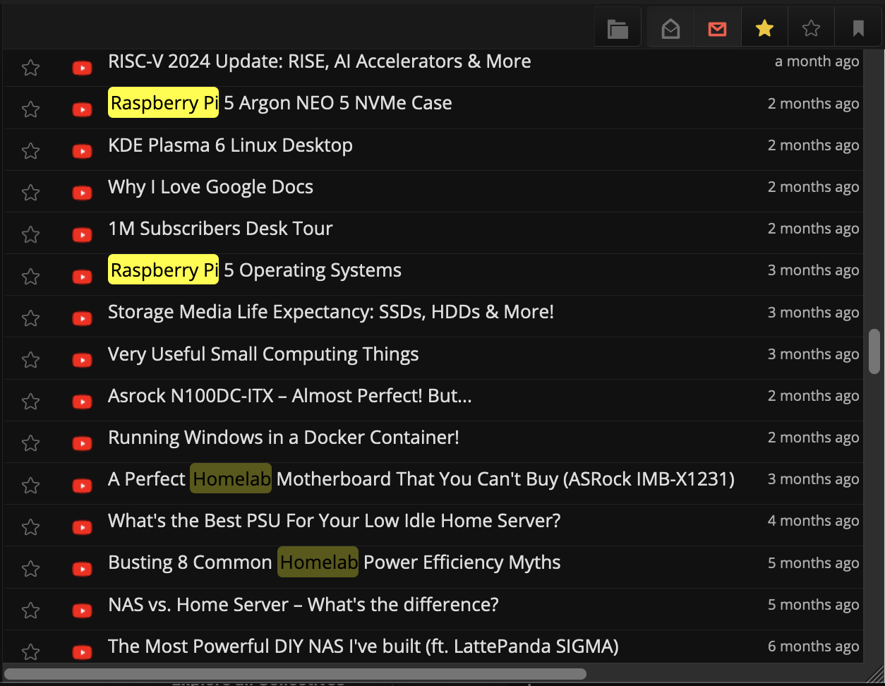

# WordHighlighter extension

A FreshRSS extension which give ability to highlight user-defined words.

## Usage

To use it, upload this directory in your `./extensions` directory and enable it on the extension panel in FreshRSS. You can add words to be highlighted by clicking on the manage button ⚙️.
See also official docs at freshrss.github.io/FreshRSS/en/admins/15_extensions.html

## Preview

Light theme:

<!-- markdownlint-disable -->

  
click to see example screenshot in dark theme

<!-- markdownlint-enable -->

## Changelog

- 0.0.5 Settings are stored in the user configuration instead of files
  written into the extension directory, so the extension works with a
  read-only `extensions/` folder (no more "config file is not writable"
  error) and no JavaScript file is generated at runtime. Existing
  `static/config.<user>.json` settings are picked up automatically until
  saved once. Settings reach the script through `js_vars`.
  Fixed highlighting intermittently not starting: the script is loaded
  `async` and could run before `#stream` was parsed; it now waits for
  `DOMContentLoaded`. The word list textarea is now escaped.
- 0.0.3 Turkish language support added.
- 0.0.2 use `json` for storing configuration, add more configuration options
  (enable_in_article, enable_logs, case_sensitive, separate_word_search)
  and refactored & simplified code.
- 0.0.1 initial version (as a proper FreshRSS extension)
